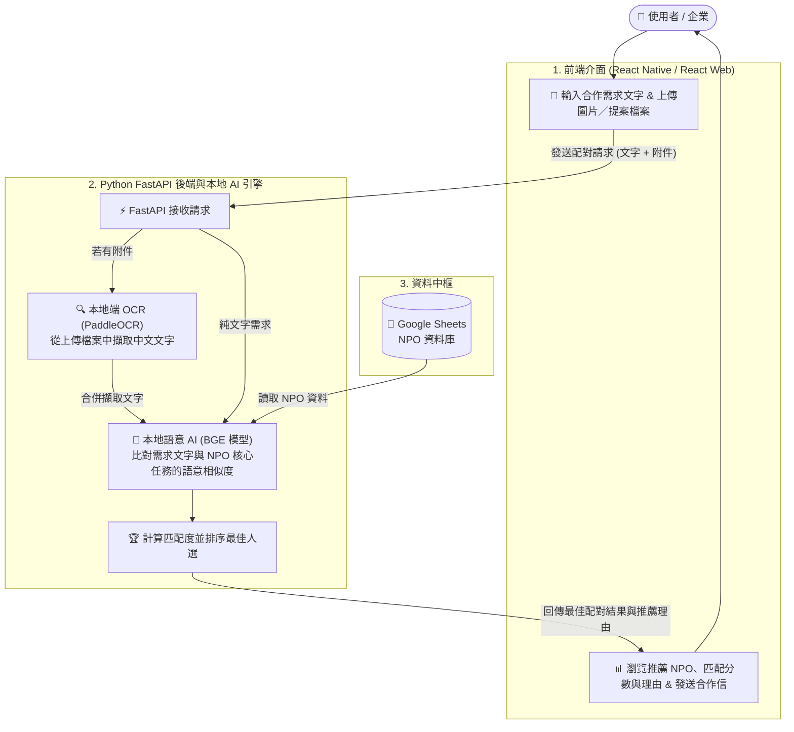

🤝 好事大平台 (Haoshi Platform)
> 一個以隱私優先的全端合作媒合平台，利用本地端繁/簡體中文 OCR 與語意 AI 嵌入技術，將企業 CSR 需求與非政府組織（NPO）進行智慧配對——完全無需付費雲端 API。
<p align="center">
  
  &nbsp;&nbsp;&nbsp;&nbsp;
  
</p>

---

## 🏗️ 系統架構流程



---

## 📂 專案目錄結構

```text
haoshi-platform/
│
├── backend/                 # Python FastAPI 伺服器與 AI 引擎
│   ├── main.py              # FastAPI 端點與 CORS 設定
│   ├── ai_engine.py         # PaddleOCR 與 BGE 語意嵌入邏輯
│   ├── database.py          # gspread 讀取 Google Sheets NPO 資料
│   └── pyproject.toml       # uv 相依套件管理設定檔
│
├── mobile-app/              # React Native / Expo 行動客戶端
│   ├── App.js               # 行動裝置資料輸入介面（文字輸入與圖片選取）
│   ├── components/          # CandidateCard、EmailActionToolbar、RequestBanner
│   └── package.json         # 行動端相依套件
│
└── web-dashboard/           # React + Vite 網頁儀表板
```

---

## 🚀 快速開始與安裝指南

請依照以下步驟在本機端設定並執行後端伺服器與行動應用程式。

### 前置需求

* 已安裝 **Python 3.10+**。
* 已安裝 **`uv`**（快速 Python 套件管理工具）。
* 已安裝 **Node.js** 與 **npm**（用於執行 React Native / Expo 行動應用程式）。
* 已在實體行動裝置上安裝 **Expo Go** 應用程式（或已設定 iOS／Android 模擬器）。

---

### 步驟一：複製儲存庫並設定後端

1. 複製您的儲存庫：
```bash
git clone https://github.com/LV6LASERLOTUS/haoshi-platform.git
cd haoshi-platform/backend
```

2. 使用 `uv` 初始化並啟動 Python 虛擬環境：
```bash
uv venv
```

* **Mac / Linux：** `source .venv/bin/activate`
* **Windows：** `.venv\Scripts\activate`

3. 安裝後端相依套件：
```bash
uv add fastapi uvicorn paddleocr paddlepaddle sentence-transformers gspread pandas numpy
```

4. 啟動 FastAPI 後端伺服器：
```bash
uvicorn main:app --reload
```

* 伺服器將在 `http://127.0.0.1:8000` 啟動。
* 可前往 `http://127.0.0.1:8000/docs` 查看互動式 Swagger UI 文件。

---

### 步驟二：設定並執行行動應用程式

1. 開啟新終端機視窗，並切換至 mobile 資料夾：
```bash
cd haoshi-platform/mobile-app
```

2. 安裝相依套件：
```bash
npm install
npx expo install expo-image-picker
```

3. **設定 API 端點（使用實體裝置時必要）：**
   * 開啟 `App.js`，找到 `fetch` 的 URL。
   * 若使用 **iOS 模擬器**，保持 `http://127.0.0.1:8000/api/v1/match` 不變。
   * 若使用 **實體裝置（透過 Expo Go）**，請將 `127.0.0.1` 替換為您電腦的本機網路 IP 位址（例如：`http://192.168.1.15:8000/api/v1/match`）。

4. 啟動 Expo 開發伺服器：
```bash
npx expo start
```

5. 使用 iPhone 或 Android 裝置上的 **Expo Go** 掃描 QR 碼，即可載入資料輸入介面。

---

## 🛠️ 技術棧總覽

* **前端輸入：** React Native / Expo（iOS 與 Android）
* **後端 API：** Python（FastAPI）
* **本地端 OCR 引擎：** PaddleOCR（PP-OCRv3，支援繁體及簡體中文）
* **本地端語意 AI：** `BAAI/bge-small-zh-v1.5`（Hugging Face Transformers，完全離線運行）
* **資料中樞：** Google Sheets（透過 `gspread` 管理）
* **儀表板視覺化：** Google Looker Studio / Streamlit / Retool

---
