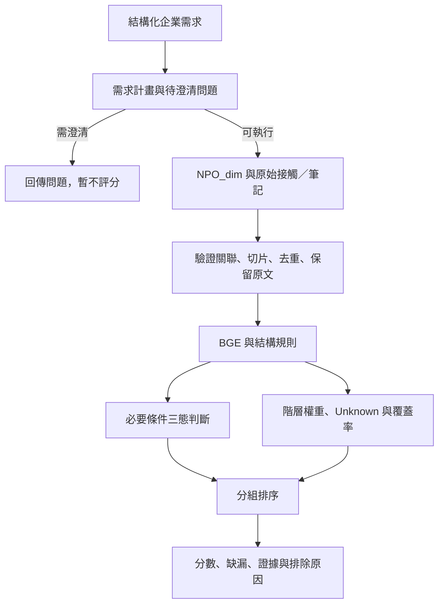

# CSR–NGO 推薦 V1：機制、規則與操作

規則版本：`csr-v1.2.0`。歷史資料不再有年份上限，改用連續時間衰減；BGE 先搜尋所有可用歷史片段，規則再確認需求與否定。權重、730 天半衰期、Unknown=30、覆蓋提醒與時間信任門檻仍是待驗證政策，不是經驗證的成功率模型。

本版變更：取消一年硬切；加入時間信任、時間調整排序分與語意參考候選；覆蓋率 60% 改為提醒，不能單獨擋掉候選。未知意願與必要條件仍不會被當成符合。

1.2 搜尋修正：三段上限改到 BGE 全歷史搜尋之後，不再先按日期挑三段。即使已命中關鍵字，仍搜尋其他說法；否定與衝突規則檢查全部歷史，不只檢查前三段。

## 1. 範圍與入口

- 產出 0–100 的「本次需求契合指數」，不是 NGO 品質、能力排名或合作成功率。
- 使用既有 `BAAI/bge-small-zh-v1.5`，不訓練新模型。
- 新端點 `POST /api/v1/recommendations/plan` 預覽規則；不讀表、不載入模型。
- 新端點 `POST /api/v1/recommendations` 讀取真實 Sheets，執行新流程。
- 舊 `POST /api/v1/match` 仍是原本 mock 契約，供既有前端使用；本次沒有接前端。不要用它驗證 V1。
- 新端點供本機／平台內部驗證，回應可能包含內部筆記原文；對企業公開之前需實作原文的角色權限。
- 來源失敗或 BGE 無法使用時回傳 503，不用假 NGO 或規則分數冒充 BGE。



## 2. 模組責任

| 檔案 | 責任 |
|---|---|
| `recommendation/schemas.py` | 需求、日期、證據、細項、資格與回應驗證 |
| `recommendation/policy.py` | 資源詞表、模板權重、門檻、版本；主要規則調整位置 |
| `recommendation/demand.py` | 型態判斷、啟用構面、正規化、澄清問題 |
| `recommendation/evidence.py` | 原始列驗證、組織關聯、片段及可追溯來源 |
| `recommendation/scoring.py` | 需求／準備度／時間／主檔評分、資格與總分 |
| `recommendation/service.py` | BGE 編碼快取、整體流程與排序 |
| `database.py` | Google Sheets 唯讀快照載入 |
| `ai_engine.py` | 既有 BGE 與 OCR；分別於需要時載入 |
| `recommendation_cli.py` | 不經前端的本機 JSON 測試入口 |

## 3. 需求結構與型態

執行時以明確結構化欄位為準。V1 沒有將整段自然語言自動轉成全部條件的功能。描述中提到「半年」卻沒有 `period` 時會要求澄清；其他日期、預算或限制仍必須由呼叫端結構化確認，不能假定已完整解析。

| 欄位 | 意義 |
|---|---|
| `description` | 需求原文；不直接混入全部 BGE 查詢 |
| `demand_type` | `professional_resources`、`issue_collaboration`、`volunteering`、`resource_support` |
| `resources` | 企業提供的資源代碼，見下一節 |
| `resource_direction` | V1 支援 `offer_to_ngo`；`seek_ngo_service` 會要求另定能力規則 |
| `resource_mode` | `any`：資源菜單符合一類即可；`all`：各類共同評分 |
| `plan_name` | 辨識本次參與承諾，不把歷史計畫當作本次計畫 |
| `period` | `start/end` 的 ISO 日期；目前只判斷這組起訖期間，不推論每週頻率或時數 |
| `issues/target_groups/areas` | 各清單內為擇一符合；跨構面加權 |
| `area_basis` | 預設 `service_area`，現有主檔不足以確認；企業明確要比較主檔區域才設 `registered_area` |
| `staff_min/staff_max` | 明確人數區間，含上下界；未指定時停用規模 |
| `memberships` | 明確會籍偏好／條件 |
| `required_conditions` | 必要條件代碼；未提供對應條件則先澄清 |
| `corporate_purpose` | ESG 報告等企業用途；不當作 NGO 必備能力、不進 BGE 查詢 |
| `target_count/candidate_limit` | 支持家數與候選上限，預設 10／30 |

型態可由明確資源代碼推導：行銷／財務／數位／影響力→專業培力；資金／物資→資源支持；單一志工→志工；未提供資源但指定議題／對象→議題型。混合且無法確定主要型態時回傳澄清問題。這個 V1 每次使用一個主模板，混合型態需由呼叫端指定主要型態，不宣稱完整自動融合所有模板。

## 4. 資料來源與排除欄位

`NPO_dim` 只建立白名單主檔：組織編號、名稱、簡介、議題、服務對象、區域、成立年、入會年、會籍、全職人數、財報類型、桑基圖上架、陪跑分級。

- 主檔與來源表依「組織編號」關聯；不以名稱猜測歸屬。
- 「重要資訊摘要」「AI分析輸入」完全不進證據模型。
- 不將主檔彙整歷史與原始表重複使用；歷史評分採 `②接觸紀錄`、`③顧問筆記`。
- 計分不使用接觸次數、筆記次數、最近接觸、財報類型、桑基圖、陪跑分級或會齡作預設加分。
- 缺編號／無法對應的歷史留在快照警示，不分配給任何 NGO。
- 顧問頁尾說明列不算筆記；主檔重複 ID、重複來源識別或關鍵表頭不完整時停止，不繼續產生貌似可信的推薦。
- `基本資料完整` 不代表參與意願或時間資料完整。

## 5. 證據切分、時效與偏誤控制

每個片段保留 `evidence_id`、組織 ID、來源表／紀錄 ID／列／連結、日期、事件名稱、來源類型、原文及原文起訖位置。

- 依句號、逗號、分號、換行及「但／但是／不過」切分；否定詞保留在原片段。
- 相同 NGO、日期與正規化片段只計一次；不同來源原文仍需人工確認矛盾是否已解決。
- 顧問筆記無紀錄 ID，使用組織、日期、記錄者及原文雜湊識別；變更原文會產生新識別。
- 歷史不設年份上限；舊紀錄仍可作需求、改善行動及語意參考。未來事件日期仍不使用，需要修正。
- 日期缺漏的歷史保留，以 0.35 時間信任作參考，不能直接確認必要條件。
- 有日期時使用 `時間信任 = 2 ** (-資料天數 / 730)`。當日 1、一年約 0.707、兩年 0.5、四年 0.25，沒有跨年突然歸零；730 天是暫定政策。
- 這是時效權重，不是陳述正確機率，也不代表組織品質。主檔不做歷史折扣（1），不等於主檔已確認為最新資料。
- 明確正負需求同時存在：Unknown，人工確認，不直接採最新一筆。
- 不同意桑基圖上架不等於拒絕其他合作；有行銷部門不等於不需行銷資源；其他計畫不等於本次沒時間。

## 6. 模板與權重

| 模板 | 起始權重 |
|---|---|
| 專業培力 | 資源需求 50%、參與準備度 25%、時間 15%、規模 10% |
| 議題合作 | 語意 50%、主要議題 20%、主要對象 15%、區域 15% |
| 志工活動 | 資源需求 50%、參與準備度 20%、時間 15%、區域 15% |
| 資源支持 | 資源需求 65%、時間 15%、區域 20% |

沒有指定的時間／規模／區域／議題／對象等停用；專業培力的資源與準備度為模板核心。額外明確偏好可加入議題／對象／區域／規模各 10%、會籍 5%、時間 15% 的原始權重，再統一正規化。這些權重均待人工評估，不同模板分數不能直接比較。

`w_j = 原始權重_j / 本次啟用原始權重總和`

- 未要求規模、有期間：專業模板為 55.56%／27.78%／16.67%。
- 未要求規模、也未指定期間：為資源 66.67%、準備度 33.33%；範例 JSON 採此設定，不假造半年日期。
- 規模只依企業明確區間給 100／0，缺資料 Unknown；不認定小型比較好。
- 議題、對象、會籍與主檔區域採正規化後精確分類比對，沒有任意模糊同義詞推論。
- 主檔議題／對象未命中可在該「主要分類」特徵給 0，但不能因此證明完全沒有該服務；必要資格仍 Unverified。
- 人數使用主檔值，附「無更新日期、不能代表當前承接能力」警示。

## 7. 資源需求規則與 BGE

目前代碼：`marketing`、`finance`、`digital`、`impact`、`volunteers`、`funding`、`materials`、`other`。完整直接／相鄰／弱相關詞表在 `policy.RESOURCES`。`other` 必須提供 `custom_resource_terms`。

| 明確需求分 | 規則 |
|---:|---|
| 100 | 原文有需求語句，命中直接資源詞 |
| 70 | 原文有需求語句，命中相鄰資源詞；顧問／審查等觀察最高暫設 70 |
| 40 | 原文有需求語句與弱線索，或為「可能、建議、可以考慮」等不確定需求 |
| 0 | 對直接資源明確說不需要／無需／沒有需求；不確定否定不作 0 |
| Unknown | 沒有明確需求證據、僅角色名稱／服務介紹、否定學習意願但未確認需求、矛盾等；不因年份久直接 Unknown |

此版為保守詞表規則，會有未涵蓋說法；未命中不代表無需求。不能把它稱為完整中文意圖／否定理解模型。

資源構面 `R = 0.6 × B + 0.4 × E`。

- 先對全部可用且有內容的歷史片段計算 BGE，不要求命中資源詞；相同正規化文字跨日期只比對一次，採較新的來源。未來日期、空白、純出席或沒有內容的片段不進搜尋。
- BGE 完成檢索後，再對全部歷史執行明確需求、否定與衝突規則。有明確需求時，以「明確程度 × 時間信任」選擇規則分的支持證據；不會因此停止其他原文的 BGE 搜尋。
- 查詢由資源詞表產生，僅查詢加 BGE 指令；不混 ESG 用途、組織人數或名額。
- 同時保留 `raw_cosine ∈ [-1,1]`；暫定 `B=100×max(0,cosine)`，標示 `uncalibrated`。
- 不以組織簡介猜培力需求。否定欲望等片段可被檢索，但經規則檢查後不作正向語意分數的支持。
- 搜尋後按 cosine 選出最多 3 段不同文字，取原始 cosine 的平均，而非只取最大值；原文與來源 ID 都會保留。時間信任採這些支持片段的平均；`evidence_age_days` 在日期皆可用時為平均天數。
- 沒有明確需求證據時，明確需求分仍 Unknown，狀態為 `semantic_candidate`，不能解讀為已確認有需求／意願。
- 固定聚合上限、去重與平均可限制文字量偏誤，但搜尋較多片段仍有多次比較偏誤；不能宣稱完全公平。低語意分只代表可查閱的參考，不保證相關。
- 明確沒有該資源需求：整個 R=0。檢索得到的否定片段 cosine 保留作診斷，語意權重位置的 0 標記 `method=rule_override`，不能讓高 cosine 抵銷拒絕。多筆否定時 raw_cosine 是其中最高值，僅用於診斷。
- 正負衝突：整個 R Unknown；沒有隱藏地以 0 或符合補值。
- `any`：取保守資源指數最高的資源類別；`all`：各資源等權平均，再展開 60/40。
- BGE／E 部分未知仍保留原葉節點權重，不放大另一項權重。
- 同需求加入無關 NGO 不會改變原 NGO 的分數。未使用候選批次 min-max。
- 相同文字向量使用有界記憶體快取；OCR 不因純文字推薦而載入。首次 BGE 需要本機模型或下載。

後續以人工評估樣本建立固定需求類型錨點或單調分段轉換；本版沒有宣稱 cosine 已跨需求校準。代表片段與固定參考集合仍有召回限制，需用人工樣本驗證。

## 8. 準備度、參與與時間

- 原文同時對應本次 `plan_name`，且明確「確認參加／確認參與／確認報名」：準備度 100。
- 明確拒絕本次計畫：準備度 0；只有企業列為必要參與條件才排除。
- 沒本次確認，但有資源相關活動中的「已開始試做、已導入、帶回組織分享、準時交功課」等獨立行動：60。
- 單純想學、出席會員大會、接觸較多：不當成準備度加分。
- 本次參與正負衝突：Unknown，不退回歷史行動來掩蓋衝突。
- 顧問猜測不能作本次已確認承諾。
- 時間需原始紀錄對應本次名稱、包含指定起訖日期，並明確「確認可參加／確認無法參加」才給 100／0；其他 Unknown。
- 時間正負衝突：Unknown。其他計畫、課程出席或主觀忙碌不能替代。
- 規則採明確措辭比對，未自動解析每週時數、跨期可投入量、窗口授權或隱含日期。需這些必要條件時應先擴充結構與證據規則。

## 9. 缺失與總分

`Not Required`：不進權重。`Known`：有分數與來源。`Unknown`：分數留 `null`，只在總分政策補值。

將階層權重展開成葉節點 `p_l`，Known 為 `k_l=1`，否則 0：

```text
coverage = Σ(p_l × k_l)
u = 1 - coverage
A = Σ(p_l × k_l × known_score_l)
match_score = A + 30 × u
known_score = A / coverage                 # coverage=0 時 null
score_range = [A, A + 100 × u]
```

Unknown=30 等價於原提案「50 填補再扣 20」，是保守政策，不是推測 NGO 實際有 30 分。`score_range` 為缺失補齊的數值範圍，不是信賴區間。覆蓋率只代表已評分需求權重，不代表正確率。

時間信任與契合分開呈現。對每個 Known 葉節點，令 `t_l` 為支持證據的時間信任（BGE 多片段平均採支持片段平均；其他同一主張的多個支持來源取最大值，不依筆數累加）：

```text
trusted_evidence_coverage = Σ(p_l × k_l × t_l)
evidence_trust = trusted_evidence_coverage / coverage  # 無證據時 0
ranking_score = Σ(p_l × k_l × t_l × known_score_l)
              + 30 × (1 - trusted_evidence_coverage)
```

`match_score` 保留內容契合度；`ranking_score` 將較舊已知資訊逐漸拉回「目前未知」的保守基準，用於組內排序。資料越久不代表內容越不相關，但對現在排序的支持力較小。Unknown 仍為 null，不把缺失調成高分。`score_range` 描述內容分數的缺失範圍，不涵蓋時間信任的不確定性，也不是 ranking_score 的上下界。

例：兩筆相同內容相隔兩年，其 cosine、需求分、match_score 相同；較舊的一筆時間信任與 ranking_score 較低。全部無證據時 match_score/ranking_score 仍為 30、覆蓋與信任為 0，不假造推薦。

正常案例：資源 B=80、E=100→R=88；準備度與時間 100，未要求規模→93.33，覆蓋率 100%。

缺漏案例：相同 R=88，準備度／時間 Unknown→62.22，覆蓋率 55.56%，已知分 88、範圍 48.89–93.33。這些只作驗收測試輸入，不寫入真實 NGO。

## 10. 必要條件、排序與候選數

- 必要條件需有明確對應需求；`semantic/readiness` 是排序特徵，不能直接當必要條件，改用具體 `participation/resource_need` 等。
- `Eligible`：確認符合；`Ineligible`：確認不符；`Unverified`：不足或矛盾。
- 任一必要條件 Ineligible 才排除；Unknown 保留在候選。
- 必要資源需明確需求 E=100，且該主張時間信任至少 0.60；相鄰／弱線索／低信任歷史仍 Unverified。`any` 至少一類確認，`all` 各類確認。
- 時間信任低於 0.60 的舊拒絕、舊無需求、舊時間承諾，不直接造成 Eligible 或 Ineligible，保留為 Unverified。這是現在資格確認的暫定門檻，不是資料年份過濾。
- 必要議題／對象的主檔未命中保持 Unverified，因為主檔不是完整服務清單。
- 沒有必要條件時資格 Eligible 表示「無必要條件被違反」，不表示所有意願已確認。

候選依組別排序：`review_candidate` →（`historical_candidate`／`semantic_candidate`／`needs_verification` 同組）→ `core_mismatch` → `insufficient_evidence`；組內使用時間調整後 ranking_score 降序、覆蓋率降序、ID 穩定排序。不以人數或接觸次數破同分。

- `review_candidate`：核心葉節點皆 Known、核心時間信任足夠、無必要條件未確認；只代表可供評估，不自動認定合適。覆蓋低於 60% 不單獨改成另一組。
- `historical_candidate`：核心有歷史依據，但時間信任不足；保留候選，需確認現在情況，包含舊的無需求紀錄。
- `semantic_candidate`：BGE 有原始片段比對，但明確需求尚未確認；不當作 NGO 已需要資源。
- `needs_verification`：核心仍無法判斷或必要條件 Unverified。
- `verification_required`：有 Unknown、必要條件待確認、覆蓋低於 60% 或整體時間信任低於 0.60 時為 true。覆蓋 60% 是提醒，不代表合作成功率，也不會單獨排除候選。
- `core_mismatch`：核心已知且皆為 0，但不是必要條件時仍保留。
- `insufficient_evidence`：覆蓋 0%，填補指數 30，保留待補證據，不認定有實際契合。
- `ineligible`：另列 `excluded` 與原因。
- 預設候選上限 `max(30, 3×target_count)`，最多 500，可明確指定；實際受資料家數限制，不補假組織。
- 支持家數是名單目標，不是 NGO 服務人數。最終十家的多樣性配置尚未實作。

## 11. 回應與追溯

每家包含：`npo_id/npo_name`、`match_score`、`ranking_score`、`known_score`、`score_range`、`subscores`、`evidence_coverage`、`evidence_trust`、`trusted_evidence_coverage`、`verification_required`、`scoring_status`、`eligibility_status/eligibility_checks`、`weights_used`、`recommendation_reasons`、`source_evidence`、`warnings`、`missing_information`、規則版本、校準狀態與快照時間。各 Known 細項包含支持來源的 `evidence_trust/evidence_age_days`。

`weights_used` 是展開後的葉節點權重；`subscores` 逐項標記狀態、原文 ID、理由、分數與實際 cosine。理由採規則模板，不由模型編造事實。所有評分／資格引用的 ID 都應能在 `source_evidence` 找到原文。

目前沒有人工審核寫回、預算計分、能力推測、LLM 自動萃取、機器學習推薦模型或公開企業端原文權限功能。

## 12. Conda 本機操作

```powershell
conda activate haoshi
cd C:\Users\User\Desktop\haoshi-platform\backend

# 只預覽；不需要網路或模型
python recommendation_cli.py examples/marketing_demand.json --plan-only

# 用憑證讀取真實資料，再使用實際 BGE；首次可能下載模型
python recommendation_cli.py examples/marketing_demand.json

# 易讀摘要：契合分、時間調整排序分、覆蓋率、時間信任及候選類別
python recommendation_cli.py examples/marketing_demand.json --summary

# 啟動 API，於 /docs 使用新 recommendations 端點
python -m uvicorn main:app --host 127.0.0.1 --port 8000

# 離線驗收；只用測試檔的明確 fixture，不連真實 Sheets／不下載模型
python -m unittest discover -s tests -p test_recommendation.py -v
```

範例 JSON 只示範企業輸入，沒有 NGO 事實。若計畫為半年，請填真實 `period.start/end`；若期間／參與必須符合，明確加入 `required_conditions`。不要用虛構日期填齊真實企業需求。

後續每次調整詞表、權重、時效、否定規則或填補係數，需更新 `policy.VERSION`、本文件與驗收案例。人工評估應保留獨立驗證需求，檢查前幾名相關性、候選召回、缺資料與不同紀錄量群組的偏誤。
