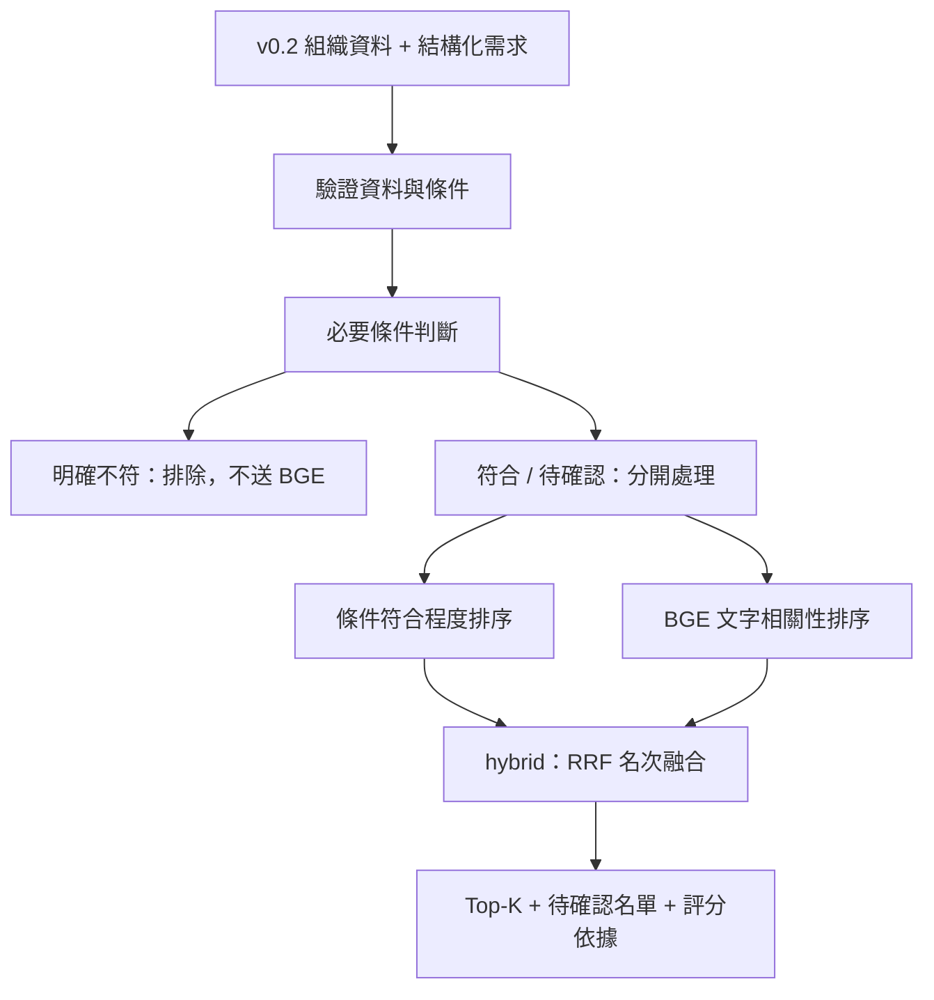

# 條件推薦與 BGE 如何並進

目前實作於 `recommendation/`，可從 Python 或命令列執行。
既有 `/api/v1/match` 尚未切換到這個新入口；前端仍使用原流程。

## 執行順序



「並進」指兩種策略獨立計分，不是要求同時佔用 CPU/GPU。
目前 48 家資料量小，對所有未排除的組織評分，再取 Top-K。
不先取 BGE 前 10 名或規則前 10 名，因此另一種策略仍能找到不同候選。
未來資料變多時再做候選召回與索引，並先量測候選召回率。

## 三種模式

| 模式 | 排序依據 | BGE 是否必須可用 |
| --- | --- | --- |
| `rules` | 明確欄位的加權支持度 | 否，不載入模型 |
| `bge` | 文字的餘弦相似度 | 有可比較文字時需要 |
| `hybrid` | 規則榜與 BGE 榜的 RRF 融合 | 有可比較文字時需要 |

三種模式共用必要條件判斷，`bge` 也不能越過明確的條件限制。
若必要條件未知或僅部分符合，只進 `pending_matches`，不以高相似度升為已符合。
必要條件不足以確定時，`eligible` 只表示通過此次明確設定的條件，不表示合作能力已驗證。
模型不可用時顯示錯誤；使用者可以明確改用 `rules`，不會暗中換成其他分數。

## 結構化需求

範例見 [recommendation-request-example.json](recommendation-request-example.json)。
招募 10 家來自圖片的任務情境，地區與偏好則是為示範另外設定的條件，並非圖片已規定。

- `text`：交給 BGE 的需求原文。
- `criteria`：表單或 PM 明確填寫的條件；本版不自動把自由文字轉成必要條件。
- `required`：true 為必要條件，false 為偏好，預設 false。
- `weight`：條件之間的正數權重，預設 1；範例等權，只是起點，尚未用標註案例調整。

| 欄位 | 支援的操作 | 意義 |
| --- | --- | --- |
| `issue_tags`、`target_groups`、`regions` | `any_of` / `all_of` | 任一命中 / 全部涵蓋 |
| `full_time_staff_count` | `between` | 包含上下限的整數範圍 |
| `membership_status`、`financial_report_type`、`support_tier` | `one_of` | 明確指定可接受類別，沒有預設高低 |

上架欄位意思尚未確認，因此不接受作為條件。
每個欄位最多一個條件；不自動將「中部」展開成縣市，也不把近義詞當相同欄位值。
地區目前只比對原始 `regions`，不能推論是實際服務範圍。

## 缺值、規則分數與排序

每個條件輸出 `matched`、`partial`、`mismatched` 或 `unknown`，以及來源欄位依據。
`all_of` 的部分涵蓋率為命中項目數 / 要求項目數；其他已知條件為 0 或 1。
未知值的單項 `score` 為 null；全職人數 0 是已知的零。

輸出同時保留：

- `rule_score`：已知條件的加權平均；無已知條件時為 null。
- `coverage`：已知條件權重 / 全部指定條件權重；沒有條件時為 null。
- `rule_support`：已確認符合的加權貢獻 / 全部條件權重，作為規則排序依據。

例如三個等權條件只有一個已知且符合，`rule_score=1`、`coverage=1/3`、
`rule_support=1/3`。這樣不會只因資料少就取得滿分排序；未知狀態仍單獨保留。
權重計算先按最大權重縮放，避免多個大權重加總溢位。
所有條件皆未知時規則分數保持 null，不建立虛假的規則名次。

## BGE 讀哪些文字

使用與現有程式相同的 `BAAI/bge-small-zh-v1.5`：

1. 主檔中的議題、服務對象與區域，組成一段簡短文字。
2. 最近 3 筆有內容的接觸紀錄，各自編碼。
3. 最近 2 筆顧問筆記，各自編碼。

日期未知的紀錄排在已知日期之後。每段最多 240 個字元，再由模型分詞處理；
不把所有歷史拼成長段落，避免後面的紀錄完全被模型截斷。
截取範圍以外的內容這次不參與語意比較，引用證據顯示實際使用的文字。

各來源類型內先取平均，再對有資料的來源類型等權平均，避免單靠筆數增加分數。
這是可替換的第一版聚合方式，仍需真人標註案例驗證是否適合任務。
相似度高只代表文字相關；筆記中的保留意見、過時資訊與合作意願都不能自動解讀成承諾。
日期與來源會回傳，但本版沒有宣稱已判定資料有效期或事實真偽。

模型只在需要時載入，預設只讀本機檔案，不觸發下載，也不載入 OCR。
查詢依 [BGE 模型卡](https://huggingface.co/BAAI/bge-small-zh-v1.5) 加上檢索指令，候選文字不加指令。
採用批次正規化向量；依 [Sentence Transformers 文件](https://sbert.net/docs/package_reference/sentence_transformer/model.html)
的 `normalize_embeddings` 與 `local_files_only` 介面實作。
同一 scorer 物件快取最多 2048 段文字向量，內容改變就重算，不跨程序持久化。
更換模型或權重版本時建立新的 scorer，避免沿用舊快取。

若服務原本已載入同一個 SentenceTransformer，可以使用
`BgeScorer(encoder=既有模型物件)` 注入重用，不需另外載入一份。
目前未修改 `ai_engine.py`；接 API 時應在服務啟動層統一管理模型生命週期。

## 融合方式

先在已符合與待確認兩個群組內各自排名，再套用：

```text
RRF = 1 / (60 + 規則名次) + 1 / (60 + BGE名次)
```

沒有某一種可用分數，就不加入該項；兩種皆無則不產生融合分數。
同分使用同名次，最後以組織 ID 固定顯示順序，不把 ID 當成適合程度。
此方式依排名融合，避免直接相加不同意義的原始分數，參見
[RRF 官方說明](https://www.elastic.co/docs/reference/elasticsearch/rest-apis/reciprocal-rank-fusion)。
`rrf_k` 可設定，預設 60；尚未宣稱這個設定在本任務上最佳。
`ranking_score`、`rule_score` 與 `semantic_score` 都不是合作成功機率，不能直接顯示成百分比成功率。

## 執行與檢視結果

在 `backend/` 執行：

```bash
# 完全不需要 BGE 的獨立推薦
python -m recommendation docs/recommendation-example.json --request docs/recommendation-request-example.json --strategy rules --output .cache/recommendation-rules.json

# 本機已準備好 BGE 時，比較三種模式
python -m recommendation docs/recommendation-example.json --request docs/recommendation-request-example.json --strategy compare --output .cache/recommendation-comparison.json
```

`--model` 可以指定本機 BGE 模型目錄；此實作的查詢指令以中文 BGE v1.5 為前提。
程式入口為 `recommend(dataset, request, strategy="hybrid", semantic_scorer=...)`。
結果包含 Top-K、待確認、排除名單、分項明細、語意引用片段、數量與耗時。
不足 K 家時如實回傳，不補入必要條件未確認的組織。

`elapsed_ms` 是單次執行量測，可能包含模型載入與首次編碼；`compare` 依序跑三種模式，
後面的 hybrid 會重用前面 BGE 的模型與向量快取。因此不能直接用這份結果比較策略速度，
也不能當成新需求、冷啟動或正式服務的 P95 延遲。
目前仍需完成獨立冷／熱啟動與不同需求的延遲測試，才能判定 issue 的 200ms 目標。

假資料只能檢查流程與規則，下一步需人工標註需求與候選組織的適合程度，
再比較三種模式的推薦品質，接著把選定的策略接到 API 與前端。
