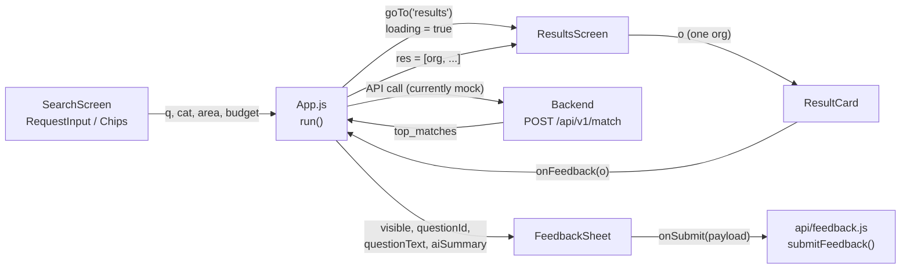

# 好事大平台 Mobile App — Architecture Guide

This doc explains what each file does, how data moves through the app, and **where to connect the real backend** so the result cards show live data.

---

## 1. File Map

```
mobile-app/
├── index.js                  # Expo entry point; registers App
├── App.js                    # Root: theme, search state, page transition, ⭐ API call, FeedbackSheet host
├── theme.js                  # LIGHT / DARK palettes + ThemeCtx + useT() hook
│
├── api/
│   ├── match.js              # ⭐ fetchMatches(): POST /api/v1/match + backend → card mapping
│   └── feedback.js           # ⭐ submitFeedback() (placeholder, no backend yet) + makeQuestionId()
│
├── data/
│   └── orgs.js               # Mock orgs + static option lists + mock score()
│
├── screens/
│   ├── SearchScreen.js       # Page 1: header, hero, input, category & example chips
│   └── ResultsScreen.js      # Page 2: top bar + back button, result list, sort, saved
│
└── components/
    ├── Header.js             # Logo + app name + ◐ theme toggle
    ├── Hero.js               # Blue hero banner with illustration
    ├── RequestInput.js       # Text box, 🖼/📎 buttons, advanced filters, 開始媒合
    ├── ResultsHeader.js      # "找到 N 個推薦單位" + sort switch
    ├── ResultCard.js         # ⭐ One recommended org (renders the result data)
    ├── FeedbackSheet.js      # 💬 回饋修正 bottom-sheet modal (rating, type, comment)
    ├── SavedBar.js           # Bottom bar shown when ≥1 org is saved
    │
    ├── art/
    │   ├── Logo.js           # SVG logo (3 squares)
    │   └── HeroArt.js        # Hero illustration (renders assets/custom_art.png)
    │
    └── ui/                   # Reusable, data-agnostic primitives
        ├── Pop.js            # Cartoon box with a solid offset "hard shadow"
        ├── PopBtn.js         # Pressable button built on Pop
        ├── Chip.js           # Pill toggle (filled = selected, dashed = suggestion)
        ├── Layout.js         # <Label> section title, <Row> wrapping flex row
        ├── Ring.js           # Circular % match indicator
        ├── Skeleton.js       # Pulsing placeholder while loading
        ├── BackButton.js     # Round ← button (top-right of results page)
        └── Toast.js          # <Toast> + useToast() hook for short messages
```

> `components/CandidateCard.js`, `SearchBar.js`, `EmailActionToolbar.js` and `template.js` (legacy) have been removed.

---

## 2. How Data Flows



1. User types / picks chips on **SearchScreen**. State (`q`, `cat`, `area`, `budget`) lives in **App.js**.
2. Pressing **開始媒合** (or an example chip) calls `run()` in **App.js**.
3. `run()` immediately slides to **ResultsScreen** with `loading = true` (skeletons show).
4. When data arrives, `run()` calls `setRes(list)` and `setLoading(false)`.
5. **ResultsScreen** sorts the list and renders one **ResultCard** per org.
6. Tapping **💬 回饋修正** on a card calls `onFeedback(o)` → `openFeedback(o)` in **App.js**, which opens the single app-level **FeedbackSheet** for that org (see section 4.1).

---

## 3. ⭐ Where to Add the Backend Request

> [!NOTE]
> ✅ **Done.** `runSearch()` in [App.js](./App.js) now calls `fetchMatches()` from [api/match.js](./api/match.js). The backend URL defaults to `localhost:8000` (iOS / web) or `10.0.2.2:8000` (Android emulator); set `EXPO_PUBLIC_API_BASE` in `.env` to override (e.g. your computer's LAN IP for a physical phone). The code below is the original plan, kept for reference.

**Only one place needs to change:** the `setTimeout(...)` block inside `run()` in [App.js](./App.js).

Current (mock):

```js
setTimeout(() => {
  const f = { cat, area, budget };
  setRes(ORGS.map((o) => ({ ...o, p: score(o, query, f) })).sort((a, b) => b.p - a.p).slice(0, 4));
  setLoading(false);
}, 900); // ← 換成真正的 API 呼叫
```

### Recommended: create `api/match.js`

Keep networking + data mapping out of the UI:

```js
// mobile-app/api/match.js
// iOS simulator: http://localhost:8000
// Android emulator: http://10.0.2.2:8000
// Physical phone: http://<your-computer-LAN-IP>:8000
export const API_BASE = 'http://localhost:8000';

export async function fetchMatches({ text, cat, area, budget, file }) {
  const form = new FormData();
  form.append('request_text', text);
  // Not yet read by the backend — add these Form(...) params in main.py when ready:
  form.append('category', cat);
  form.append('area', area);
  form.append('budget', budget);
  if (file) form.append('uploaded_file', { uri: file.uri, name: file.name, type: file.type });

  const r = await fetch(`${API_BASE}/api/v1/match`, { method: 'POST', body: form });
  if (!r.ok) throw new Error(`HTTP ${r.status}`);
  const json = await r.json();
  return json.top_matches.map(toCard);
}

// Backend shape → ResultCard shape (see section 4)
function toCard(m) {
  const pct = Math.round(m.match_score * 100);
  return {
    n: m.npo_name,
    p: pct,
    why: m.reason,
    c: m.category ?? '—',
    a: m.area ?? '—',
    t: m.tags ?? [],
    w: m.warnings ?? [],
    s: m.breakdown ?? { 領域: pct, 地區: pct, 預算: pct, 經驗: pct },
  };
}
```

Then in **App.js** replace the `setTimeout` block:

```js
import { fetchMatches } from './api/match';

// inside run(), after goTo('results'):
fetchMatches({ text: query, cat, area, budget })
  .then(setRes)
  .catch(() => { toast('連線失敗，請稍後再試'); setRes([]); })
  .finally(() => setLoading(false));
```

You can then remove the `ORGS` / `score` imports from App.js (but keep `CATS`, `AREAS`, etc. in `data/orgs.js`, since the UI uses them).

### Current backend contract (`backend/main.py`)

`POST /api/v1/match`, `multipart/form-data`

| Field | Type | Required |
|---|---|---|
| `request_text` | string | ✅ |
| `uploaded_file` | file (image) | optional, OCR'd and appended to the query |

Response:

```json
{
  "status": "success",
  "processed_query": "...",
  "top_matches": [
    { "npo_name": "...", "match_score": 0.8731, "focus_summary": "...", "reason": "..." }
  ]
}
```

> [!NOTE]
> `match_score` is **0–1**; the card expects **0–100** (`p`). The backend currently returns only 2 matches and no category / area / tags / breakdown, so `toCard()` fills in defaults. Add those fields to the backend response to light up the full card.

---

## 4. ⭐ ResultCard Data Shape

`ResultCard` receives one org object as prop `o`. These are the fields it reads:

| Field | Type | Used for | Backend source (today) |
|---|---|---|---|
| `n` | string | Org name; first character is the avatar | `npo_name` |
| `p` | number 0–100 | % in the Ring | `match_score * 100` |
| `why` | string | "✦ AI 推薦原因" box | `reason` |
| `c` | string | Service category in subtitle | ❌ add to backend |
| `a` | string | Region in subtitle | ❌ add to backend |
| `t` | string[] | Blue tags | ❌ add to backend |
| `w` | string[] | ⚠ warning tags (use `[]` if none) | ❌ add to backend |
| `s` | `{ 領域, 地區, 預算, 經驗 }` numbers 0–100 | "比對細節" bars + 地區/預算 sorting | ❌ add to backend |

Mock-only fields (not needed from the backend): `k` (keywords for mock scoring), `b` (budget band for mock scoring).

> [!IMPORTANT]
> `n` is used as the React `key` and the saved-items ID. If two orgs can share a name, add an `id` field and switch `key={o.n}` / `saved[o.n]` in `ResultsScreen.js` to `o.id`.

Other card actions that are still placeholders (they show a toast):

| Action | File | What to connect |
|---|---|---|
| 聯絡此單位 | `ResultCard.js` | `Linking.openURL('mailto:' + o.email)` or a contact page |
| 💬 回饋修正 submit | `api/feedback.js` → `submitFeedback()` | Currently logs + resolves after 400 ms. Replace with `POST /api/v1/feedback` (see 4.1) |
| 比較已收藏 | `ResultsScreen.js` → `SavedBar` | Compare screen / export |
| 🖼 照片 / 📎 檔案 | `RequestInput.js` | `expo-image-picker` / `expo-document-picker`, then pass `file` to `fetchMatches` |

### 4.1 💬 Feedback (FeedbackSheet)

The old inline feedback chips in `ResultCard` were replaced by `components/FeedbackSheet.js`, a bottom-sheet `Modal`. There is **one instance, rendered in `App.js`** (outside the page transition, next to `<Toast>`), so it overlays the whole app.

State in **App.js**:

| State | Purpose |
|---|---|
| `feedbackOrg` | The org being reviewed. Kept after close so the content doesn't blank out during the slide-out animation |
| `feedbackVisible` | Sheet open / closed. Reset to `false` on every new search |
| `questionId` | Generated per search with `makeQuestionId(searchId)` → `Q-YYYYMMDD-NNNN` |

Props passed: `theme={theme}`, `questionId`, `questionText={submittedQuery}`, `aiSummary={feedbackOrg.why}`, `onSubmit={submitFeedback}`.

The sheet resets its form each time `visible` goes `true`. If `onSubmit` throws, it shows 「送出失敗，請稍後再試一次」; if it resolves, it shows the thank-you screen (plus a JSON preview of the payload in `__DEV__`).

Submitted payload:

```json
{
  "question_id": "Q-20261113-0042",
  "question_text": "…",
  "ai_summary": "…",
  "rating": 4,
  "feedback_type": "推薦與需求不符",
  "feedback_content": "…"
}
```

`feedback_type` is one of: 推薦符合需求, 推薦與需求不符, 組織資訊有誤, 缺少關鍵資訊, 推薦理由不充分, 資料已過時, 其他建議 (`feedback_content` is required only for 其他建議).

> [!WARNING]
> The backend has no feedback endpoint yet, so `submitFeedback()` is a placeholder that always succeeds. The payload also has **no org identifier**. When you add `POST /api/v1/feedback`, consider sending `org name / id` too (`feedbackOrg.n`). `questionId` is client-generated and restarts at `0001` when the app relaunches, so it's not globally unique. Ideally the backend returns a `question_id` from `/api/v1/match`.

---

## 5. Component Reference

### Screens

| File | Props | Notes |
|---|---|---|
| `SearchScreen` | `q, setQ, cat, setCat, area, setArea, budget, setBudget, onRun, onToggleTheme, toast` | Stateless; all search state is owned by App |
| `ResultsScreen` | `query, loading, res, onBack, onFeedback, toast` | Owns `sort` + `saved`. Remounted on each new search (`key={searchId}`), which resets both. `onFeedback(o)` is forwarded to each card |

### Feature components

| File | Props | Notes |
|---|---|---|
| `Header` | `onToggleTheme` | |
| `Hero` | — | Static content (badges in `BADGES` const) |
| `RequestInput` | `value, onChangeText, area, onAreaChange, budget, onBudgetChange, onSubmit, toast` | Owns focus + advanced-panel open state |
| `ResultsHeader` | `count, sort, onSortChange` | Sort options from `SORTS` in `data/orgs.js` |
| `ResultCard` | `o, i, top, saved, onSave, onFeedback, toast` | `i` = index (badge #, avatar color, fade-in delay); `top` = highlight as 最推薦; `onFeedback` fires from 💬 回饋修正 |
| `FeedbackSheet` | `visible, onClose, theme, questionId, questionText, aiSummary, onSubmit, showDevPreview` | Rendered once in `App.js`. Takes `theme` as a prop instead of `useT()`. Defines its own local `Pop` (not `ui/Pop`). `showDevPreview` defaults to `__DEV__` |
| `SavedBar` | `count, onCompare` | Absolutely positioned at bottom |

### UI primitives (`components/ui/`)

| File | Key props |
|---|---|
| `Pop` | `r` radius, `off` shadow offset, `bw` border width, `bg`, `sc` shadow color, `pressed` |
| `PopBtn` | `onPress, bg, color, bold, r, style` |
| `Chip` | `label, on, onPress, dashed` |
| `Layout` | `<Label>`, `<Row style>` |
| `Ring` | `p` (0–100) |
| `Skeleton` | — |
| `BackButton` | `onPress` |
| `Toast` | `msg, opacity, bottom` with `const { show, msg, opacity } = useToast()` |

---

## 6. Conventions

- **Theme:** every component calls `const c = useT()` (exception: `FeedbackSheet` receives `theme` as a prop) and uses `c.ink`, `c.surface`, `c.primary`, etc. Never hard-code colors that should change in dark mode. Add new colors to both `LIGHT` and `DARK` in `theme.js`.
- **Navigation:** a simple 2-page slide in `App.js` (`page` state + `nav` Animated value). The Android back button is handled with `BackHandler`. If the app grows beyond 2–3 screens, migrate to Expo Router (see `AGENTS.md`).
- **Styling:** inline styles, matching the original template. Reuse `Pop` / `PopBtn` / `Chip` to keep the cartoon look consistent.
